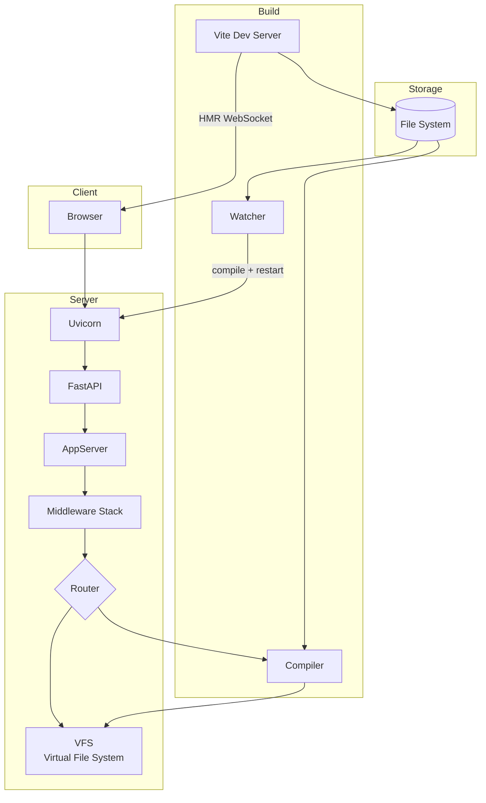
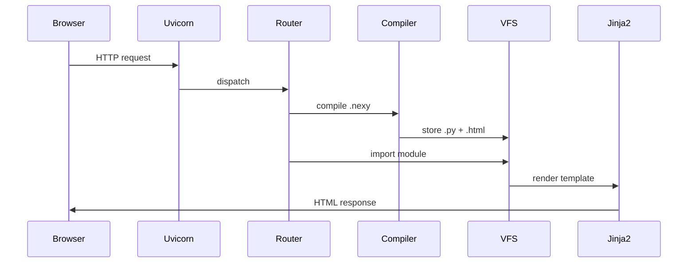
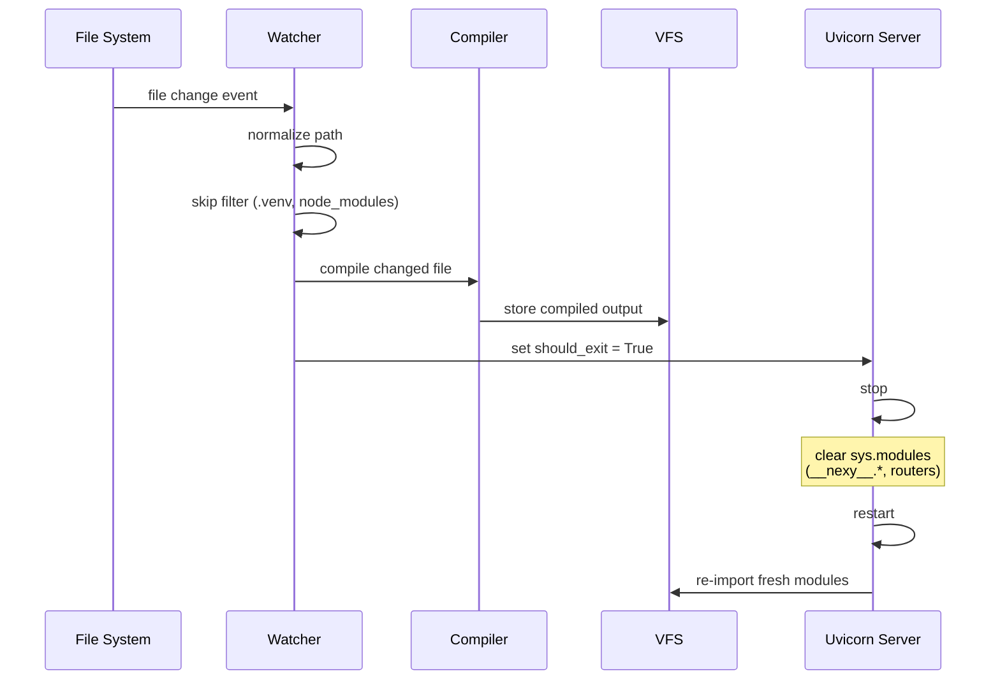
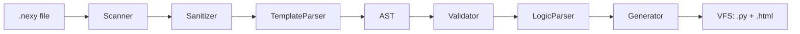

# Architecture

## Overview

Nexy is a full-stack Python meta-framework that bridges FastAPI backends with
Vite-powered frontends (React, Vue, Svelte, Solid, Preact). It compiles `.nexy`
components at runtime through a Virtual File System (VFS), and a file watcher
triggers clean uvicorn restarts - no importlib hacks, no stale modules.

## System diagram



## Data flow

### Request lifecycle



### Dev mode file watching



## Package layout

```
nexy/
├── app.py                     # uvicorn target: nexy.app:app → AppServer().run()
├── __init__.py                # public facade (Audio, Video, Form, Import, Template, Vite, …)
├── decorators.py              # Injectable, Container, Controller, Module, UseGuard, Middleware
├── router.py, vite.py …       # facade re-exports + component helpers (audio, form, image, link, script, video)
├── core/                      # framework core
│   ├── config.py              # nexyconfig.py loader (user project root)
│   ├── models.py              # Pydantic models (FrontendFramework, …)
│   ├── string.py              # route-name transforms
│   └── types.py
├── helpers/                   # transversal layer - zero upward imports
│   ├── common/                # console, formatting, json, process, report
│   ├── fs/                    # vfs (VFS singleton), path, scan, frontmatter, fingerprint
│   ├── imports/               # component, css, images, ncc import rewriting
│   └── server/                # uvicorn_config, ports
└── modules/                   # feature modules
    ├── builder/               # production build assembly (parallel executor)
    ├── cli/                   # Typer app - 10 commands
    │   ├── commands/          # new, dev, build, start, init, check, format, migrate, test, translate
    │   └── devtools/          # watcher (fs events → compile → clean restart), pycache
    ├── compiler/              # .nexy → route modules
    │   ├── parser/            # scanner, sanitizer, template, validator, logic
    │   ├── generator/         # Python code generation
    │   ├── frontend_route.py  # .tsx/.jsx/.mdx route compiler
    │   └── markdown_route.py  # .md route compiler
    ├── frontend/              # per-framework integrations
    │   ├── react.py, vue.py, svelte.py, solid.py, preact.py
    │   ├── vite_entry.py      # useFF contract: normalize_ff, frameworks_of
    │   ├── vite.ts            # Vite plugin
    │   └── runtime.ts         # browser runtime
    ├── i18n/                  # locale routing, middleware
    ├── routers/               # app (AppServer assembly), fbrouter/, actions/
    │   ├── middlewares.py, static_assets.py, hmr.py, error_handlers.py
    └── runtime/               # importer (PEP 302), cache, hmr, markdown
```

## Key modules

### Virtual File System (VFS)

In-memory singleton (`helpers/fs/vfs.py`, class `VFS`) storing compiled `.py`
and `.html` files. Survives across uvicorn restarts - always has fresh
compiled content.

- **NexyVFSFinder** (PEP 302 meta-path finder): intercepts `__nexy__.*` imports
- **NexyVFSLoader** (`importlib.abc.SourceLoader`): loads from VFS instead of disk
- Both live in `modules/runtime/importer.py`, registered via `sys.meta_path`

### Compiler pipeline



1. **Scanner** - extracts `---` frontmatter delimiter
2. **Sanitizer** - rewrites framework-specific syntax (vue ↔ react ↔ nexy)
3. **TemplateParser** - HTML to AST, validates component references, excludes built-in `Slot`
4. **Validator** - ensures every imported component resolves on disk, with did-you-mean suggestions
5. **LogicParser** - compiles Python frontmatter to Jinja2 expressions
6. **Generator** - produces `__nexy__/*.py` and `__nexy__/*.html` in VFS

Dedicated compilers handle other route kinds: `frontend_route.py` for
`.tsx`/`.jsx`/`.vue`/`.svelte`/`.mdx`, `markdown_route.py` for `.md`.

The Python compiler never compiles what Vite compiles. For a framework route, including `.mdx`,
`frontend_route.py` writes only a thin wrapper module that serves the route; Vite compiles the
source and the SSG scripts pre-render it at build time. `.nexy` goes through the pipeline above and
`.md` through `cmarkgfm`.

### Routing

**File-based router (FBR)**: `src/routes/index.nexy` → `/`,
`src/routes/blog/[slug].nexy` → `/blog/{slug}`. Auto-discovery from filesystem,
`layout.nexy` files for shared layouts, supports `.nexy`, `.mdx`, `.md`, `.py`
(plus `.tsx`, `.vue`, `.svelte` when that framework is configured).

**Modular router**: NestJS-inspired controllers with `app_controller.py` +
`app_module.py`. Decorator-based routing with DI
(`@Injectable`, `@Controller`, `@Module`, `@UseGuard`).

## Design decisions

| Decision | Rationale |
|----------|-----------|
| VFS instead of disk | No filesystem pollution, instant re-import |
| uvicorn restart > importlib.reload | Module cache clearing is deterministic |
| esbuild > Vite for SSR | Per-file builds, no Vite dependency in production |
| Jinja2 for .nexy | Mature, extensible, same engine as Django |
| Custom watcher > uvicorn --reload | Fine-grained control, debouncing, Vite coordination |
| sys.modules clearing | Fresh module state on every restart |
| Pydantic for config | Type safety, IDE autocomplete, schema gen |
| Slot as built-in component | No import needed in .nexy - always available |

## Performance

Reference targets measured on the development machine:

- **Startup**: under a second (compile + server ready)
- **HMR**: < 100 ms file change → browser refresh
- **SSR**: ~5–15 ms per component (esbuild)
- **SSG**: parallel worker pool, one worker per CPU core

## Security

- Jinja2 autoescaping is **off**: `.nexy` templates are the project's own HTML. Escape untrusted
  values with `| e`.
- CORS, GZip, TrustedHost, Session, Auth middleware
- Signed session cookies
- Environment variables for secrets (never hardcoded)
- `.nexy` frontmatter is Python and runs per request, and the Jinja2 environment is not sandboxed:
  treat route files as application code, never as user input
