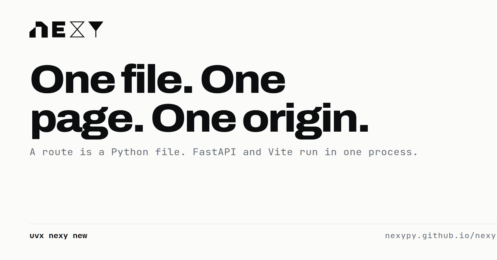

<p align="center">
  
</p>

# Nexy

**Next.js, in Python.** Same file routes, same layouts, same islands. The server code becomes Python:
a page, a route handler and a server action are Python files, and FastAPI and Vite run in one
process, so a project keeps one server, one origin, and no CORS block.

<p>
  <a href="https://pypi.org/project/nexy"></a>
  <a href="https://pypi.org/project/nexy"></a>
  <a href="https://pypi.org/project/nexy"></a>
  <a href="https://github.com/NexyPy/nexy/actions/workflows/ci.yml"></a>
  <a href="https://github.com/NexyPy/nexy"></a>
  <a href="https://github.com/NexyPy/nexy/blob/main/LICENSE"></a>
  <a href="https://github.com/NexyPy/nexy/commits/main"></a>
</p>

<p align="center">
  <a href="https://nexypy.github.io/nexy/"><strong>Documentation</strong></a> ·
  <a href="#quick-start">Quick start</a> ·
  <a href="#coming-from-nextjs">From Next.js</a> ·
  <a href="https://github.com/NexyPy/nexy/discussions">Discussions</a> ·
  <a href="https://github.com/NexyPy/nexy/blob/main/CONTRIBUTING.md">Contributing</a>
</p>

## Quick start

```bash
uvx nexy new my-app        # scaffold the project and its .venv
cd my-app
source .venv/bin/activate  # Windows: .venv\Scripts\activate
nexy dev                   # http://localhost:3000
```

Python 3.12+ and [uv](https://docs.astral.sh/uv/). Node.js 18+ only when the project uses a client
framework.

`uvx` runs Nexy in a temporary environment: enough to **create** a project, nothing more. Any other
command runs inside the project's `.venv`, where your own packages live - outside it, a page fails
with `ModuleNotFoundError: No module named 'sqlmodel'`. `uv run nexy dev` skips the activation.

`new` asks four questions - file-based or modular router, web or API, client framework or none,
ORM or none - and the answers decide what the scaffold writes, including the Node package manager
it reuses: a committed lockfile wins when that tool is installed, otherwise `bun`, `pnpm` then
`npm` by priority.

## Coming from Next.js

`src/routes/` replaces `app/`, and a route is a file rather than a `page.tsx` inside a folder:

| Next.js | Nexy |
|---|---|
| `app/page.tsx` | `src/routes/index.tsx`, or `index.nexy` with Python in it |
| `app/blog/[slug]/page.tsx` | `src/routes/blog/[slug]/index.tsx` |
| `app/layout.tsx` | `src/routes/layout.tsx`, or `layout.nexy` |
| `app/api/items/route.ts` | `src/routes/api/items.py`, with `GET` and `POST` functions |
| `app/loading.tsx`, `error.tsx`, `not-found.tsx` | `loading.nexy`, `errors.nexy`, `notfound.nexy` |
| a `"use client"` component | the same `.tsx` file, imported as an island |
| a Server Action | an `@Action` function |

One setting decides the shape in `nexyconfig.py`: `useCSR = True` keeps `.tsx` pages and client
navigation, like `app/`; the default renders `.nexy` pages on the server, with the React components
you already have as islands. Either way the server is FastAPI, `/docs` lists every handler, and one
process serves the HTML and the API.

## Coming from another framework

The Next.js shape is one door; the others lead to the same framework. The file routes, layouts and
islands of the JavaScript meta-frameworks carry over, and so do the controllers, modules and
injectable services of the backend ones:

| You come from | What carries over |
|---|---|
| **Remix**, Nuxt, SvelteKit | file routes, layouts, islands, Server Actions written in Python |
| **Astro** | server-first HTML, the same islands and `client:*` directives, Markdown pages |
| **NestJS**, Spring Boot | controllers, modules, injectable services, guards |
| **Django**, Flask, FastAPI | views, endpoints, `Depends`, Pydantic models |

[Coming from another framework](https://nexypy.github.io/nexy/docs/getting-started/coming-from-other-frameworks/)
maps sixteen of them, one page per framework, with the code you know and then the Nexy code.

## Why Nexy

A route is a file. Put a `.nexy` file under `src/routes/` and you get a page: Python for the logic,
Jinja2 for the markup, an optional React, Vue, Svelte, Solid or Preact component for interactivity.
Put a `.py` file there and you get an API handler: the function names are the HTTP methods.

The server is FastAPI and Starlette. The client is Vite. No second process, no second origin, no
glue project between the frontend and the backend.

| You get | Instead of |
|---|---|
| One process, one origin | A front end, an API, and a CORS block between them |
| One file = server logic, markup, interactive island | Separate API, UI and build-tooling projects |
| Zero-config Vite integration | Hand-wiring Webpack, Vite or Parcel |
| Any supported client framework, or none | Being locked into React or Vue |
| SSR, ISR and parallel SSG built in | SSG bolted on afterwards |

Change a file, the page reloads: `nx dev` recompiles the routes you touched and proxies Vite through
its own port, so the browser only ever talks to `3000`.

**Measured, not claimed**: an 87-line page with three component imports compiles in 1.6 ms, median of
25 runs on a Ryzen 5 4500U. That is the compile step alone: a browser reload also pays for Vite's
module graph and the browser's own render, so this is not an HMR figure.

An issue queue that gets answered: 204 issues closed, 92 pull requests merged, latest 2.2.2 on
2026-11-05.

## A page, an endpoint, an island

### A page

Python on top, HTML in the middle, CSS at the bottom.

```nexy
---
from nexy import usePathname

title: prop[str] = "Hello"
pathname = usePathname()
---
<article class="post">
  <h1>{{ title }}</h1>
  <p>You are on {{ pathname }}</p>
</article>

<style>
  .post { max-width: 60ch; }
</style>
```

Everything between the `---` lines is Python. Imports resolve at compile time; the rest runs on
every request. `prop[type]` declares a property, `= value` gives it a default.

The body is Jinja2 with the frontmatter variables in scope. Autoescaping is **off**: escape
untrusted values with `{{ value | e }}`, and wrap JavaScript containing `{{` or `{%` in
`...`. Declare props before using them; an undeclared variable renders as an
empty string.

### An endpoint

```python
# src/routes/api/items.py  →  /api/items
from fastapi import Request
from pydantic import BaseModel


class Item(BaseModel):
    name: str


async def GET(request: Request):
    return {"items": []}


async def POST(request: Request, body: Item):
    return {"created": body.name}
```

Each function named after an HTTP method becomes an endpoint. Path segments, query strings, JSON
bodies, `Depends`, headers and uploads keep their normal FastAPI behaviour, and every handler is
published in the OpenAPI schema at `/openapi.json` and rendered by Scalar at `/docs`.

### An island

Import a client component by path; the compiler mounts it and passes the attributes as props. This
is not a client-only island: the HTML exists before the bundle runs, so the first paint does not
wait for JavaScript.

```nexy
---
from "@/components/Counter.tsx" import Counter
---
<Counter start="0" />
```

## Project layout

```text
my-app/
├─ src/
│  ├─ routes/            file-based routes (FBR)
│  │  ├─ index.nexy      → /
│  │  ├─ layout.nexy     shared layout, not a route
│  │  └─ api/hello.py    → /api/hello
│  ├─ apps/              modular router, decorators (optional, next to routes/)
│  ├─ components/        imported components (a convention, not enforced)
│  └─ globale.css        global styles (created by `nexy new`)
├─ public/               served at /
├─ nexyconfig.py         project configuration
├─ pyproject.toml
├─ package.json          only with a client framework
├─ vite.config.ts        only with a client framework
└─ __nexy__/             build output - generated, never edited
```

## Routing

The URL is the file path relative to `src/routes/`, minus the extension.

| File | URL |
|---|---|
| `index.nexy` | `/` |
| `about.nexy` | `/about` |
| `blog/index.nexy` | `/blog` |
| `blog/[slug].nexy` | `/blog/{slug}` |
| `docs/[...path].nexy` | `/docs/{path:path}` |
| `(marketing)/pricing.nexy` | `/pricing` |
| `api/users.py` | `/api/users` |

`index` maps to its directory, not to `/index`. A directory in parentheses is a group: it organises
files without appearing in the URL. Files and folders starting with `_` or `.` are ignored, which is
the place for partials and drafts.

These names are not routes: `layout.nexy`, `loading.nexy`, `errors.nexy`, `notfound.nexy`,
`dependencies.py`, `__init__.py`. A `layout.*` wraps every page in its directory and below, and
receives the page as `children`. `notfound.*` answers `404`, `errors.*` answers `500`, and
`dependencies.py` applies its FastAPI dependencies to that subtree.

One file per URL. `blog.nexy` next to `blog/index.nexy` registers two routes for the same path; pick
one.

Dynamic segments become page properties: `[slug]` gives a `str`, `[...path]` gives one string with
the slashes included. In a `.nexy` page only `int` and `float` annotations are converted.

[Routing reference →](https://nexypy.github.io/nexy/docs/routing/)

## Views

A view renders the page body. Pick one format per file.

| Format | File | Server render | Client framework |
|---|---|---|---|
| `.nexy` | page | Jinja2 + Python logic, streamed | optional |
| `.md` | pure Markdown | markdown-it-py at request time, GFM, layout-wrapped | optional via layout |
| `.mdx` | Markdown with components | framework SSR | React or Preact |
| `.tsx`, `.jsx` | component | framework SSR / SSG | React or Preact |
| `.vue` | SFC | framework SSR / SSG | Vue |
| `.svelte` | SFC | framework SSR / SSG | Svelte |

Markdown pages get heading IDs and a generated table of contents, and support locale variants such
as `about.fr.md`. The framework for `.mdx` is detected from the imports: Preact when
the file imports `preact`, React otherwise.

```python
# nexyconfig.py
from nexy.core.models import NexyConfigModel
from nexy.frontend import react


class NexyConfig(NexyConfigModel):
    useFF = react()  # vue(), svelte(), solid(), preact()
```

With a framework enabled, its extensions become active routes, and `nx new` sets it up with Vite and
Tailwind. `useVite` defaults to `True`.

[Views →](https://nexypy.github.io/nexy/docs/views/) · [.nexy files →](https://nexypy.github.io/nexy/docs/views/nexy/) · [Markdown →](https://nexypy.github.io/nexy/docs/views/nexy/markdown/)

## Rendering modes

| Mode | How | Behaviour |
|---|---|---|
| SSR | default | rendered per request by Jinja2, or by the framework at build time for framework routes |
| ISR | `revalidate = 60` in the frontmatter | in-process, per-path cache; sends `Cache-Control: public, s-maxage=60, stale-while-revalidate=60` |
| CSR | `useCSR = True` in `nexyconfig.py` | first load returns HTML, then the client router navigates; `.nexy` routes are disabled |
| SSG | `nx build` | framework routes pre-rendered to HTML by a per-file esbuild pipeline, one file per worker |

CSR requires a client framework and is incompatible with a modular `useRouter`. Only `.tsx`,
`.jsx`, `.vue` and `.svelte` routes are navigable client-side; `.md` can use a CSR shell.

[SSR →](https://nexypy.github.io/nexy/docs/rendering/ssr/) · [CSR →](https://nexypy.github.io/nexy/docs/rendering/csr/) · [ISR →](https://nexypy.github.io/nexy/docs/rendering/isr/)

## More server features

### WebSocket

Define `SOCKET` in a `.py` route file to register a WebSocket at the same path:

```python
# src/routes/ws/chat.py
from fastapi import WebSocket


async def SOCKET(websocket: WebSocket):
    await websocket.accept()
    await websocket.send_text("hello")
    await websocket.close()
```

### Modular routing

Files are the default, not the only option. Classes and decorators produce an `APIRouter` mounted
with `useRouter`:

```python
# src/apps/app_controller.py
from nexy.decorators import Controller
from nexy.core.types import JsonResponse


@Controller(prefix="/users")
class UserController:
    def get(self) -> JsonResponse:
        return {"users": []}
```

```python
# nexyconfig.py
class NexyConfig(NexyConfigModel):
    useRouter = AppModule  # a module class or any APIRouter
```

Methods are matched by name, case-insensitively; duplicates raise at startup. `@Injectable()`
classes are resolved into a controller's `__init__`, with `Scope.SINGLETON`, `Scope.REQUEST` and
`Scope.TRANSIENT` lifetimes, and `@UseGuard()` / `@Middleware()` add FastAPI dependencies.
File-based routing keeps working alongside a modular router.

[Modular routing →](https://nexypy.github.io/nexy/docs/routing/modular/)

### Actions

`@Action` turns a function into a `POST` endpoint with a generated path, so a page can call server
code without declaring a route file:

```python
# src/actions/user.py
from nexy.decorators import Action


@Action
async def create_user(name: str) -> dict:
    return {"name": name}
```

```nexy
<form method="post" action="{{ __actions_path['create_user'] }}">
  <input name="name">
  <button type="submit">Create</button>
</form>
```

The path is deterministic (a hash of the module and function name). It keeps the endpoint out of
casual discovery but is not a secret; do not rely on it for authorization.

[Actions →](https://nexypy.github.io/nexy/docs/guides/actions/)

## Hooks and components

Hooks read the current request from inside a `.nexy` page. Calling one outside a request raises
`RuntimeError`.

| Hook | Returns |
|---|---|
| `usePathname()` | request path, e.g. `"/blog/post-1"` |
| `useSearchParams()` | query string as `dict[str, str]`, first value per key |
| `useQuery()` | dynamic path parameters, e.g. `{"slug": "post-1"}` |
| `useRouter()` | `{"path", "base_url", "url_for"}` |
| `useCookies()` | all cookies as `dict[str, str]` |
| `useSession()` | the session dict, `{}` when sessions are not enabled |
| `useToc(depth_range="2-6")` | table of contents HTML, `""` when there is none |
| `useViews(path, context=None)` | renders another view and returns an `HTMLResponse` |

Built-in helpers return HTML strings, usable as a Jinja call or as a tag:

```nexy
{{ Audio("/theme.mp3", controls=True) }}

<Audio src="/theme.mp3" controls=True />
```

| Helper | Purpose |
|---|---|
| `Image` | `` with lazy loading and explicit dimensions |
| `Link` | `<a data-nexy-link>`, prefetched on hover and handled by the client router |
| `Audio`, `Video` | media tags, with `<source>` children derived from `sources` |
| `Import` | imports a component from Python, like the template syntax |

[Hooks →](https://nexypy.github.io/nexy/docs/routing/fbr/navigation/hooks/) · [Components →](https://nexypy.github.io/nexy/docs/views/nexy/components/)

## Internationalization

Nexy ships no runtime i18n: an application picks the library it prefers. The command line itself is
translated. See the [i18n guide](https://nexypy.github.io/nexy/docs/guides/i18n/).

## Config

Configuration is a class in `nexyconfig.py` at the project root. Nexy loads it from the directory it
runs in; a project without the file uses the defaults.

```python
from nexy.core.models import NexyConfigModel
from nexy.frontend import react


class NexyConfig(NexyConfigModel):
    useFF = react()
    usePort = 3000
    useHost = "0.0.0.0"
    useTitle = "My App"
    useAliases = {"@": "src/"}
    useCORS = {"allow_origins": ["https://example.com"]}
```

| Area | Fields |
|---|---|
| Server | `usePort`, `useHost`, `useSslKeyfile`, `useSslCertfile`, `useCSR` |
| Routes | `useRouter`, `useAliases`, `excludeDirs`, `useLayoutExtensions`, `useNotFoundExtensions`, `useErrorsExtensions`, `useLoadingExtensions` |
| Frontend | `useFF`, `useVite`, `useMarkdownExtensions`, `useWatchExtensions`, `useWatchExcludePatterns` |
| API docs | `useDocs`, `useDocsUrl`, `useTitle` |
| Middleware | `useMiddlewares`, `useCORS`, `useGZip`, `useTrustedHost`, `useSession`, `useAuth`, `useHTTPSRedirect` |
| Markdown | `useTocDepth`, `useTocTitle`, `useTocAuto` |

[Every field and its default →](https://nexypy.github.io/nexy/docs/reference/config/)

## CLI

The binary is `nx`, also installed as `nexy`. `uvx nexy new` creates a project (`uvx` comes with
uv); run every other command inside the project's virtual environment.

| Command | Alias | What it does |
|---|---|---|
| `nx dev` | `nx d` | development server: compile on change, Vite, HMR |
| `nx start` | `nx s` | production server on the compiled output |
| `nx build` | `nx b` | production build |
| `nx new` | `nx n` | scaffold a project |
| `nx init` | `nx i` | add Nexy to an existing project |
| `nx migrate` | `nx m` | ORM migrations: autogenerate a revision, `--init`, `--upgrade` |
| `nx check` | `nx c` | type-check: mypy on Python, `tsc` on TypeScript |
| `nx format` | `nx f` | format Python, JS/TS and `.nexy` files |
| `nx test` | - | run pytest; `--client` adds vitest, `--no-server` skips pytest |

`--port` and `--host` override `usePort` and `useHost` for `dev` and `start`; `--check` runs ruff and
mypy after `build`, and reports instead of rewriting for `format`; `--template` / `-t` skips the
`new` prompts.

[All flags →](https://nexypy.github.io/nexy/docs/reference/cli/)

## Build and deploy

```bash
nx build
nx start --host 0.0.0.0 --port 8000
```

`nx build` writes everything to `__nexy__/`: the compiled Python routes, the client bundle under
`__nexy__/client/`, and the pre-rendered HTML for framework routes. `nx start` runs Uvicorn on that
output - Python only, no Node process and no Vite process at runtime.

Deploy by copying the project with `__nexy__/`, or build inside the image. The build stage needs
Node and Python; the runtime stage needs Python only.

```dockerfile
FROM node:22-bookworm-slim AS build
WORKDIR /app
COPY --from=ghcr.io/astral-sh/uv:latest /uv /usr/local/bin/uv
COPY pyproject.toml uv.lock ./
RUN uv sync --frozen --no-install-project
COPY . .
RUN uv sync --frozen && uv run nx build

FROM python:3.13-slim
WORKDIR /app
COPY --from=build /app /app
ENV PATH="/app/.venv/bin:$PATH"
EXPOSE 8000
CMD ["nx", "start", "--host", "0.0.0.0", "--port", "8000"]
```

Static hosting is a deployment choice, not a build mode: there is no `--static` flag. Put static
files in `public/`; they are served from `/` in development and production. Behind a reverse proxy,
remember to forward WebSocket upgrade requests.

[Deploy guide →](https://nexypy.github.io/nexy/docs/deployment/)

## How it works

- A `.nexy` file is compiled to a Python module in `__nexy__/`, mounted through a virtual file
  system, and rendered with Jinja2 at request time.
- Framework routes are pre-rendered to HTML at build time by a per-file esbuild pipeline; the worker
  pool runs one file per worker, sized to the CPU count. A route whose server render fails is
  reported as client-only instead of failing the build.
- In development, the watcher recompiles what changed and restarts Uvicorn cleanly - no importlib
  hacks, no stale modules. Vite runs on an internal port and Nexy proxies it through the app origin.
- In production, one Uvicorn process serves the routes, the HTML and the assets from one origin.

Internals, request lifecycle and compiler pipeline: [ARCHITECTURE.md](https://github.com/NexyPy/nexy/blob/main/ARCHITECTURE.md).

## How it compares

Capabilities, not timings. This repository has measured its own compile step and nothing else, so
the only figure it publishes is that one: the startup and HMR numbers you read elsewhere were taken
on another machine, against another project, and are not comparable.

| Feature | Nexy | Next.js | Django + HTMX | Remix |
|---|---|---|---|---|
| Language | Python + any JS framework | JS/TS only | Python + HTMX | JS/TS only |
| Server process | Uvicorn + FastAPI, one process | Node | Python (ASGI/WSGI) | Node |
| File format | `.nexy` (Python + Jinja2 + UI) | `.tsx` / `.jsx` | `.py` + `.html` | `.tsx` |
| SSR | Built-in (esbuild) | Built-in (React) | Manual | Built-in (React) |
| SSG | Parallel worker pool | `output: 'export'` | Third-party | Via Vite |
| Islands | Any of five frameworks | Client components | HTMX attributes | Hydrated routes |
| Server actions | `@Action` | Server Actions | Form posts | `action` |
| Routing | File-based + modular | File-based | Manual | File-based |

## Framework support

| Framework | SSR | SSG | HMR |
|---|:---:|:---:|:---:|
| React | ✓ | ✓ | ✓ |
| Vue | ✓ | ✓ | ✓ |
| Svelte | ✓ | ✓ | ✓ |
| Solid | ✓ | ✓ | ✓ |
| Preact | ✓ | ✓ | ✓ |
| None (vanilla) | ✓ | - | ✓ |

## Documentation

This README is the front door. The pages below go deeper on one topic each, in plain Markdown, and
are written from the code.

| I want | Read |
|---|---|
| to create a project and run it | [Getting started](https://nexypy.github.io/nexy/docs/getting-started/quick-start/) |
| the files and folders | [Project structure](https://nexypy.github.io/nexy/docs/getting-started/project-structure/) |
| the URL of a file | [Routing](https://nexypy.github.io/nexy/docs/routing/) |
| dynamic segments, layouts, error pages | [Pages](https://nexypy.github.io/nexy/docs/routing/fbr/pages/) |
| the current path, query, cookies, session | [Hooks](https://nexypy.github.io/nexy/docs/routing/fbr/navigation/hooks/) |
| to write a page | [.nexy files](https://nexypy.github.io/nexy/docs/views/nexy/) |
| Markdown or MDX | [Markdown](https://nexypy.github.io/nexy/docs/views/nexy/markdown/) |
| built-in HTML helpers | [Components](https://nexypy.github.io/nexy/docs/views/nexy/components/) |
| SSR, CSR, ISR | [SSR](https://nexypy.github.io/nexy/docs/rendering/ssr/), [CSR](https://nexypy.github.io/nexy/docs/rendering/csr/), [ISR](https://nexypy.github.io/nexy/docs/rendering/isr/) |
| a WebSocket | [WebSocket](https://nexypy.github.io/nexy/docs/routing/fbr/realtime/websocket/) |
| controllers and modules | [Modular routing](https://nexypy.github.io/nexy/docs/routing/modular/) |
| to add an endpoint | [API](https://nexypy.github.io/nexy/docs/routing/fbr/handlers/) |
| a form posted from a page | [Actions](https://nexypy.github.io/nexy/docs/guides/actions/) |
| translations | [i18n](https://nexypy.github.io/nexy/docs/guides/i18n/) |
| a config field | [Config](https://nexypy.github.io/nexy/docs/reference/config/) |
| the client build and Vite | [Frontend](https://nexypy.github.io/nexy/docs/guides/frontend/) |
| every command and flag | [CLI](https://nexypy.github.io/nexy/docs/reference/cli/) |
| to test a project | [Testing](https://nexypy.github.io/nexy/docs/guides/testing/) |
| build output and Docker | [Deploy](https://nexypy.github.io/nexy/docs/deployment/) |
| rules for an AI agent | [AI agents](https://nexypy.github.io/nexy/docs/guides/ai-agents/) |

[llms.txt](llms.txt) is the same map in one file, for tools that read plain text.

## Contributing

Contributions are welcome - seasoned engineers and first-time PR authors alike.

- [Good first issues](https://github.com/NexyPy/nexy/issues?q=is%3Aissue+is%3Aopen+label%3A%22good+first+issue%22)
- [CONTRIBUTING.md](https://github.com/NexyPy/nexy/blob/main/CONTRIBUTING.md) - setup, quality gates, pull requests
- [ARCHITECTURE.md](https://github.com/NexyPy/nexy/blob/main/ARCHITECTURE.md) - internals
- [Discussions](https://github.com/NexyPy/nexy/discussions) for questions, ideas and showing what you built
- [Issues](https://github.com/NexyPy/nexy/issues) - bugs and feature requests

Security issues: see [SECURITY.md](https://github.com/NexyPy/nexy/blob/main/SECURITY.md). Do not open a public issue for a vulnerability.

## License

[MIT](LICENSE) - free forever, built in the open.
