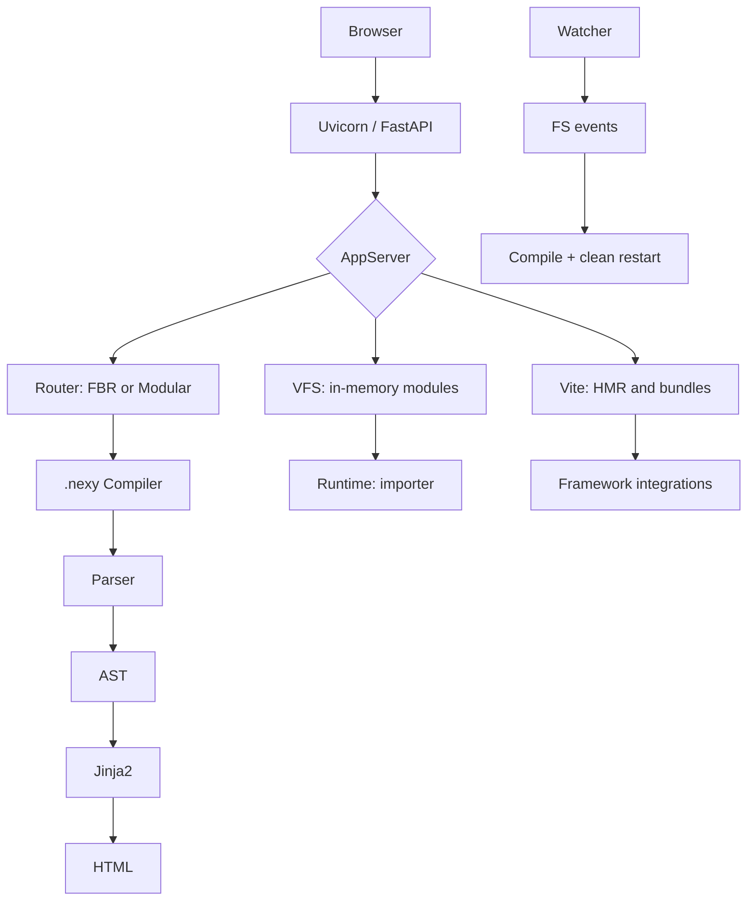

<p align="center">
  
</p>

<h1 align="center">Nexy</h1>

<p align="center">
  <strong>The fullstack Python meta-framework.</strong><br/>
  FastAPI backend, Vite-powered frontend, one file per page - startup in under a second, HMR in under 100&nbsp;ms.
</p>

<p align="center">
  <a href="https://pypi.org/project/nexy"></a>
  <a href="https://pypi.org/project/nexy"></a>
  <a href="https://github.com/NexyPy/nexy/actions/workflows/ci.yml"></a>
  <a href="https://github.com/NexyPy/nexy"></a>
  <a href="LICENSE"></a>
  <a href="https://github.com/NexyPy/nexy/commits/main"></a>
</p>

## Why Nexy

Every Python web framework forces a choice: backend **or** frontend. Nexy refuses it. One `.nexy` file carries the server logic (Python), the markup (Jinja2), and the interactive islands (React, Vue, Svelte, Solid, Preact) - wired to FastAPI and Vite with zero config.

| You get | Instead of |
|---------|------------|
| Sub-second startup | 10–30&nbsp;s waiting for Next.js, Rails, Django |
| One `.nexy` file = backend + frontend | Separate API, UI, and build-tooling projects |
| Zero-config Vite integration | Hand-wiring Webpack, Vite, Parcel |
| Framework-agnostic components | Being locked into React **or** Vue |
| SSR + SSG out of the box, parallel build | SSG bolted on afterwards |

## Quick start

No `pip install` required - `uvx` downloads and runs the CLI in one step:

```bash
uvx nexy new          # wizard picks the UI framework
nexy dev              # localhost:3000, sub-100ms HMR
```

Your browser opens on `localhost:3000`. Change a file. Instant feedback.

## The `.nexy` file - one format, three layers

A single file that mixes Python, Jinja2, and your frontend framework of choice:

````html
---
title : prop[str] = "Dashboard"
from "@/components/Chart.tsx" import Chart
---

<h1>{{ title }}</h1>

<Chart data="{{ api_data }}" />
````

| Layer | Language | Role |
|-------|----------|------|
| `---` frontmatter | Python | Typed props, imports, server logic |
| Body | Jinja2 | Server-rendered markup |
| Components | TS/JS/Vue/Svelte/Solid | Interactive islands via Vite |

## Architecture



**Key design choice:** production SSR runs through a per-file esbuild pipeline - no Vite dependency at runtime. SSG runs a worker pool sized to the CPU count, so rebuilds stay sub-second regardless of project size.

## How it compares

| Feature | Nexy | Next.js | Django + HTMX | Remix |
|---------|------|---------|---------------|-------|
| Language | Python + any JS framework | JS/TS only | Python + HTMX | JS/TS only |
| Startup | < 1&nbsp;s | 10–30&nbsp;s | 3–8&nbsp;s | 8–15&nbsp;s |
| HMR | < 100&nbsp;ms | ~500&nbsp;ms | N/A | ~300&nbsp;ms |
| File format | `.nexy` (Python + Jinja2 + UI) | `.tsx` / `.jsx` | `.py` + `.html` | `.tsx` |
| SSR | Built-in (esbuild) | Built-in (React) | Manual | Built-in (React) |
| SSG | Parallel worker pool | `next export` | Third-party | Via Vite |
| Routing | File-based + modular | File-based | Manual | File-based |

## Framework support

| Framework | SSR | SSG | HMR |
|-----------|:---:|:---:|:---:|
| React | ✓ | ✓ | ✓ |
| Vue | ✓ | ✓ | ✓ |
| Svelte | ✓ | ✓ | ✓ |
| Solid | ✓ | ✓ | ✓ |
| Preact | ✓ | ✓ | ✓ |
| None (vanilla) | ✓ | - | ✓ |

## CLI

| Command | Purpose |
|---------|---------|
| `nexy new` | Scaffold a project with your framework of choice |
| `nexy dev` | Dev server with sub-100ms HMR |
| `nexy build` | Production build (SSR + SSG + client bundles) |
| `nexy start` | Production server (Uvicorn + FastAPI) |

Eleven commands ship with the CLI (`add`, `check`, `format`, `migrate`, `test`, `translate`, …) - run `nexy --help` for the full list.

## Roadmap

- [x] Core compiler + dual routing (file-based and modular)
- [x] Vite + HMR for React, Vue, Svelte, Solid, Preact
- [x] Parallel SSG with a worker pool
- [ ] Framework-selection scaffold wizard
- [ ] One-click deploy targets (Docker, Vercel, Fly.io)
- [ ] First-class AI/agent endpoints

## Contributing and community

Contributions are welcome - seasoned engineers and first-time PR authors alike.

- [Good first issues](https://github.com/NexyPy/nexy/issues?q=is%3Aissue+is%3Aopen+label%3A%22good+first+issue%22) · [CONTRIBUTING.md](CONTRIBUTING.md) · [Discussions](https://github.com/NexyPy/nexy/discussions)
- [Documentation](https://nexy.ai/docs) - full reference
- [Issues](https://github.com/NexyPy/nexy/issues) - bugs and feature requests
- [Discord](https://discord.gg/nexy) - community chat

## License

[MIT](LICENSE) - free forever, built in the open.
