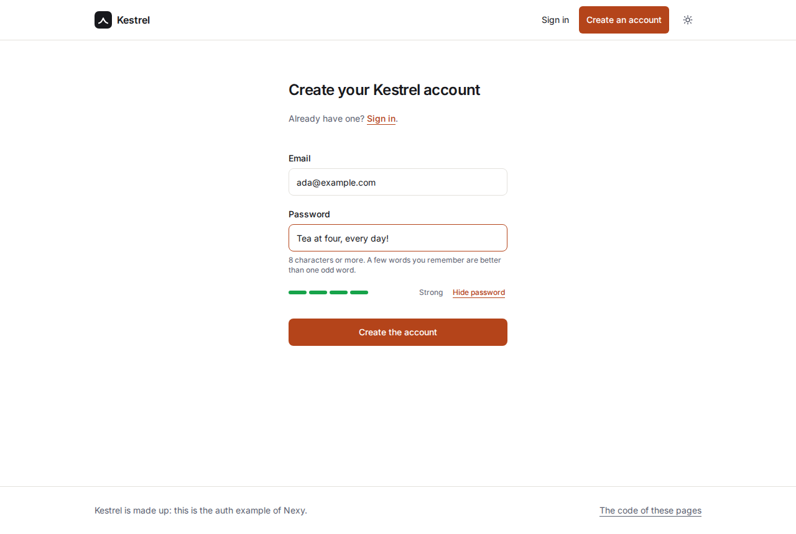

# Auth: sign up, sign in, a protected page, sign out

Kestrel is a made-up reading tracker, and these are its account pages: create an account, sign in,
see your account, change your password, sign out. Every form posts to an action and works without
JavaScript. The session is a signed cookie, passwords are hashed with scrypt from the standard
library, and the accounts live in SQLite. A Vue island adds a Show password button and, for a new
password, how hard it is to guess.



## What it shows

| Nexy feature | Where |
|---|---|
| Sessions in a signed cookie, turned on with `useSession` | `nexyconfig.py` |
| `useSession()` read and written by actions and pages | `src/accounts/session.py` |
| A page that sends a visitor who is not signed in elsewhere, with `redirect()` | `src/routes/account.nexy` |
| Actions that answer forms with a redirect | `src/actions/accounts.py` |
| A Vue island with `client:load` that adds to a server form | `src/components/password-help.vue` |
| A value from the address printed escaped with the `e` filter | `src/routes/signin.nexy` |
| Tests that send the hostile input: forged cookies, open redirects, guessing | `tests/` |

## Run it

You need Python 3.12 or newer, [uv](https://docs.astral.sh/uv/), and Node.js with npm, pnpm or
bun.

```bash
git clone https://github.com/NexyPy/nexy
cd nexy/examples/auth
uv sync
npm install          # or pnpm install, bun install
uv run nexy dev
```

The accounts are kept in `auth.db` (`AUTH_DB` puts it somewhere else). The key that signs the
session cookie is `SESSION_SECRET`; without it, one is made at the first start and kept in
`session.key`, which git ignores. Behind HTTPS, set `SECURE_COOKIES=1` so the cookie is never sent
over plain HTTP.

## How each part is kept safe

| Risk | What the example does | Where |
|---|---|---|
| A stolen database gives the passwords away | Only a salted scrypt hash is stored, compared in constant time | `src/accounts/store.py` |
| Guessing a password | After 5 wrong passwords for one email in 15 minutes, that email waits; the password is not even checked | `src/accounts/throttle.py` |
| Learning which emails have an account | Sign-in says "Wrong email or password", never which | `src/accounts/messages.py` |
| A huge password slowing the server | Passwords are 8 to 256 characters, refused before hashing | `src/accounts/store.py` |
| A forged session cookie | The cookie is signed; one signed with another key signs no one in | `nexyconfig.py` |
| A link that signs someone in, then sends them to another site | `then` is only a path of this site: `//evil.example` and `https://...` go to `/account` | `src/accounts/session.py` |
| A link that puts words on the page | The address carries a key, `?error=wrong`; the page prints the sentence of that key | `src/accounts/messages.py` |
| A form posted from another site | The cookie is `SameSite=Lax`: the browser does not send it with a cross-site POST | `nexyconfig.py` |
| An old session kept after signing in | The session is emptied, then the account id is written | `src/accounts/session.py` |

Two limits to know. Signing up says when an email already has an account: hiding it needs an email
to confirm the address, which this example has no server to send. And the guessing limit is kept in
the memory of one process: a site with several processes keeps it in a shared store.

## The Vue island

`password-help.vue` sits under a password field, in the same wrapper, and finds the field there once
it runs. It adds a Show password button, and for a field marked `data-strength`, a meter with words:
"Easy to guess" to "Strong". It never refuses a password: the server alone decides, with one rule
for everyone, and the form works the same without the island.

## Test it

```bash
uv run pytest
```

Each test starts with no account, no failed sign-in, and a browser of its own. The tests post the
forms the way a browser does, and send what an attacker would: a forged cookie, `then` pointing to
another site, a sixth wrong password, HTML in the address.

## Files

```text
src/
  accounts/
    store.py                   the accounts in SQLite, scrypt hashes
    session.py                 who is signed in, and where to go after
    throttle.py                too many wrong passwords for one email
    messages.py                the sentences the pages show, by key
  actions/accounts.py          sign up, sign in, sign out, change the password
  components/
    Header.nexy                the name, the account links, the theme switch
    ThemeToggle.nexy           light or dark
    password-help.vue          Show password, and the strength meter
  routes/
    layout.nexy                the document around every page
    index.nexy                 the home page
    signup.nexy, signin.nexy   the two forms
    account.nexy               the protected page
    notfound.nexy              the 404 page
  globale.css                  the tokens of the theme
tests/                         the store, the guessing limit, the pages
```
