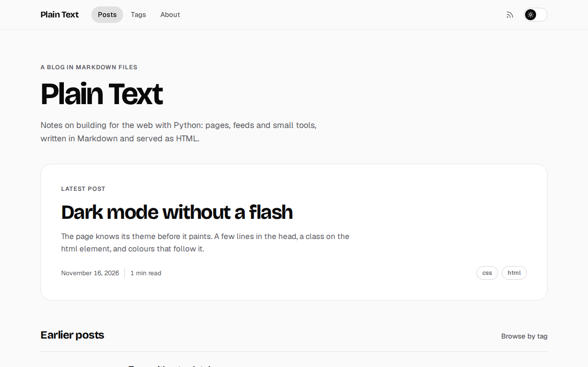

# Blog: Markdown posts rendered by Python

Plain Text is a blog whose posts are Markdown files and whose pages Nexy renders on the server: the
latest post and the list of the others, one page per post with its table of contents, tags, an
About page written in Markdown, an RSS feed and a sitemap. Every page is complete HTML in the first
answer.



## What it shows

| Nexy feature | Where |
|---|---|
| A `.nexy` page: Python above, HTML below | `src/routes/index.nexy` |
| A dynamic route, and a 404 from Python with `notFound()` | `src/routes/posts/[slug].nexy`, `src/routes/tags/[tag].nexy` |
| The title and the description of each page: `setMetadata`, `useMetadata` | `src/routes/posts/[slug].nexy`, `src/routes/layout.nexy` |
| A Markdown page with a layout of its own, in a route group | `src/routes/(pages)/` |
| A route that answers XML instead of a page | `src/routes/rss.py` |
| `/sitemap.xml` and `/robots.txt` from `useSiteUrl` | `nexyconfig.py` |
| The page of an address nothing serves | `src/routes/notfound.nexy` |
| A component that takes Python objects | `src/components/PostList.nexy` |
| Tests of every page, without a browser | `tests/` |

## Run it

You need Python 3.12 or newer, [uv](https://docs.astral.sh/uv/), and Node.js with npm, pnpm or
bun.

```bash
git clone https://github.com/NexyPy/nexy
cd nexy/examples/blog
uv sync
npm install         # or pnpm install, bun install
uv run nexy dev
```

Open the address `nexy dev` prints.

## Write a post

Add a Markdown file to `content/posts/`. Its name is its address: `my-post.md` is served at
`/posts/my-post`.

```text
---
title: My post
date: 2026-12-01
summary: One sentence for the list of posts and for the feed.
tags: python, notes
---

The text, in Markdown. Each `## Section` gets a line in the table of contents.
```

`title`, `date` and `summary` are required: a post without one stops with an error that names the
file. Save, reload, and the edit is there.

## Publish it

Set `useSiteUrl` in `nexyconfig.py` to the address the blog is published at: the feed, the sitemap
and `robots.txt` take their links from it. Then build and start:

```bash
uv run nexy build
uv run nexy start
```

## Test it

```bash
uv run pytest
```

The tests read the posts and the feed, ask the server for every page through `TestClient`, and
check that each class the pages use has a style.

## Files

```text
content/posts/              the posts, one Markdown file each
src/
  blog/posts.py             reads a post: header, HTML, sections, reading time, tags
  components/header.nexy    the name, the sections, the feed and the theme switch
  components/PostList.nexy  a list of posts
  routes/layout.nexy        the document around every page: head, header, footer
  routes/index.nexy         the latest post, then the others
  routes/posts/[slug].nexy  one post
  routes/tags/              every tag, and the posts of one
  routes/(pages)/           pages written in Markdown, with a layout for reading
  routes/rss.py             the RSS feed
  routes/notfound.nexy      the page of an unknown address
  globale.css               every style, in plain CSS
tests/                      the posts, the feed, each page and the styles
```
