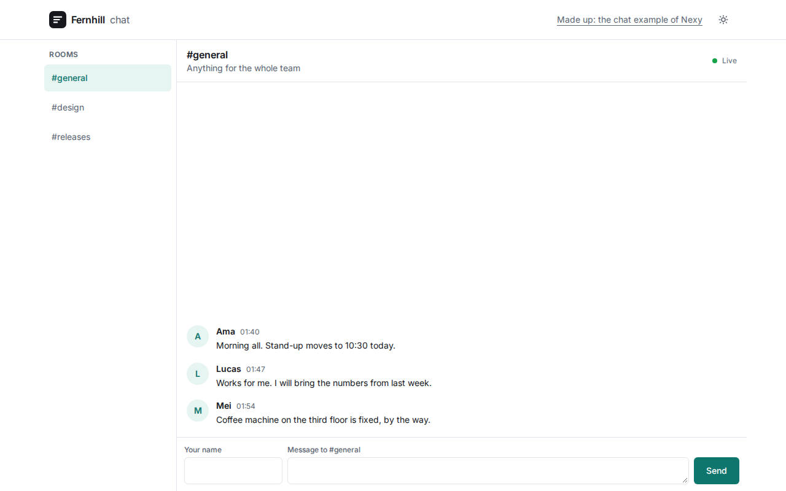

# Chat: rooms that work without JavaScript, live with Preact

Fernhill is a made-up team, and this is its chat: three rooms, a name, a message. Each room is a
page drawn by the server from SQLite, and its form posts to a Python route, so the chat works with
JavaScript off. A Preact island adds the live part: it sends without a reload, shows new messages
from the others within two seconds, and gives every time in the reader's own time.



## What it shows

| Nexy feature | Where |
|---|---|
| A dynamic page, and a 404 from Python with `notFound()` | `src/routes/rooms/[room].nexy` |
| A cookie read in a page with `useCookies`, written by a route | `src/routes/rooms/[room].nexy`, `src/routes/send.py` |
| A Python route that answers a form with a redirect, or the island with JSON | `src/routes/send.py` |
| A JSON route the island asks every two seconds | `src/routes/api/messages.py` |
| A redirect from `/` in Python | `src/routes/index.py` |
| A Preact island with `client:load` that adds to server HTML instead of drawing it | `src/components/live-room.tsx` |
| Messages typed by people, printed escaped with the `e` filter | `src/routes/rooms/[room].nexy` |
| Tests of the store, the routes and the pages, without a browser | `tests/` |

## Run it

You need Python 3.12 or newer, [uv](https://docs.astral.sh/uv/), and Node.js with npm, pnpm or
bun.

```bash
git clone https://github.com/NexyPy/nexy
cd nexy/examples/chat
uv sync
npm install          # or pnpm install, bun install
uv run nexy dev
```

Open the address `nexy dev` prints in two windows, side by side, and write in one. The messages are
kept in `chat.db`, made with the first messages the first time a room is opened: delete the file to
start again. `CHAT_DB` puts it somewhere else.

## Without JavaScript, then with it

**Without JavaScript**, the form posts to `/send`. The route stores the message, remembers the name
in a cookie, and answers `303` back to the room, at the form. The list of messages is in a
`flex-direction: column-reverse` box, so the page opens on the newest messages with no script to
scroll it. A refused message comes back as `?note=name` or `?note=text`: the address carries a key,
and the page prints the sentence of that key, so a link can never put words of its own on the page.

**With the island**, the same form is sent with `fetch`, with `accept: application/json`. The same
route then answers with the note, if any, and the messages the page has not shown yet. Every two
seconds, while the tab is visible, the island asks `/api/messages` for the messages newer than the
last one on the page. Enter sends, Shift and Enter starts a new line. A dot in the header says
"Live", or "Offline, retrying" when a request fails.

## An island that adds, never replaces

An island's HTML is rendered once, at build, without the props the page passes. So this one takes
none: it reads the room and the last message from the page. It draws only the Live dot. A new
message is a copy of the page's `<template>`, filled with `textContent`, so the HTML of a message is
written once, in the page, and nothing a person types is read as HTML.

## Test it

```bash
uv run pytest
```

Each test gets rooms of their own in a temporary folder. The tests post the form the way a browser
does, and the way the island does, and check that a name or a message with HTML in it is printed
as text.

## Files

```text
src/
  chat/store.py                the rooms and their messages in SQLite
  components/
    Header.nexy                the name and the theme switch
    ThemeToggle.nexy           light or dark
    live-room.tsx              the Preact island: send, receive, local times
  routes/
    layout.nexy                the document around every page
    index.py                   / opens #general
    rooms/[room].nexy          a room: its messages and the form
    send.py                    where the form posts
    api/messages.py            the messages newer than one, as JSON
    notfound.nexy              the 404 page
  globale.css                  the tokens of the theme
tests/                         the store, the routes, the pages
```
