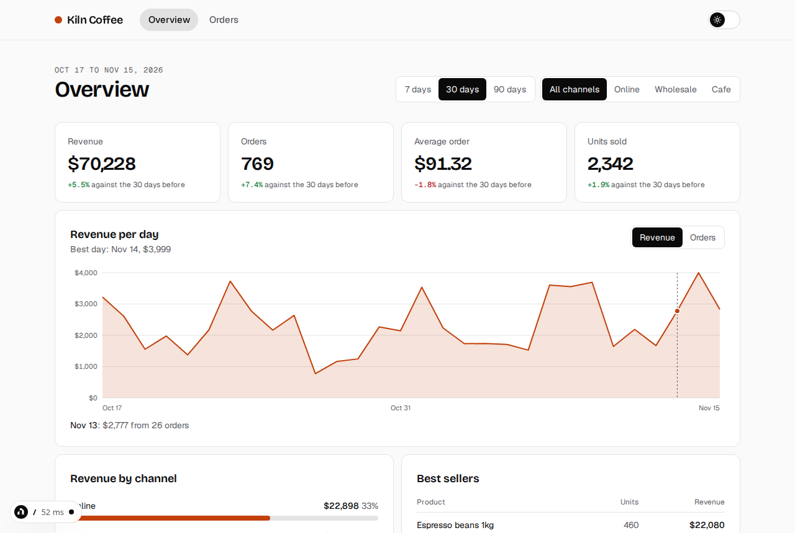

# Dashboard: a sales dashboard with Nexy controllers and React charts

Kiln Coffee is the sales dashboard of a small coffee roaster: revenue, orders, channels and best
sellers over 7, 30 or 90 days. The pages are `.nexy` views rendered on the server by modular
controllers, and the chart is a React component that reads a JSON route of the same project. The
orders are a SQLite table of SQLModel, made by Alembic migrations.



## What it shows

| Nexy feature | Where |
|---|---|
| The modular router: a module, its controllers and providers | `src/apps/app_module.py` |
| Dependency injection: services given to controllers by type | `src/apps/orders/*_service.py`, `src/apps/*/*_controller.py` |
| `.nexy` views rendered on the server with `useViews`, in a layout | `src/apps/overview/overview_view.nexy`, `src/apps/layout.nexy` |
| A React component mounted in a `.nexy` view, with props | `src/apps/overview/overview_view.nexy`, `src/components/revenue-chart.tsx` |
| `useFetch` reading a JSON route of the project | `src/components/revenue-chart.tsx`, `src/apps/api/revenue_controller.py` |
| Filters in the query string, checked before they reach a query | `src/apps/orders/window.py` |
| SQLModel and Alembic migrations, with `nexy migrate` | `src/apps/orders/order_model.py`, `alembic/versions/` |
| Tailwind with the tokens of the starter, light and dark | `src/globale.css` |
| Tests of the services, and of every page over HTTP | `tests/` |

## Run it

You need Python 3.12 or newer, [uv](https://docs.astral.sh/uv/), and Node.js with npm, pnpm or
bun.

```bash
git clone https://github.com/NexyPy/nexy
cd nexy/examples/dashboard
cp .env.example .env
uv sync
npm install                     # or pnpm install, bun install
uv run nexy migrate --upgrade   # creates the table and records four months of orders
uv run nexy dev
```

Open the address `nexy dev` prints.

## How a page is put together

A request for `/?days=7&channel=Cafe` reaches `OverviewController`. Its constructor asked for a
`MetricsService`, and the container gave it one. The controller turns the query string into a
`Window`: a period the page does not offer falls back to 30 days, and a channel it does not know
means every channel, so a value from the address never reaches SQL as it was typed.

`overview_page.py` turns the totals into text: dollars, changes against the days before, the width
of each bar. The view only lays that text out. The figures are in the first HTML, so the page reads
without JavaScript.

The chart is the one part that moves. The view mounts `RevenueChart` with the window as props, and
the component asks `/api/revenue/` for one value per day with `useFetch`. Point at a day, or focus
the chart and press the arrows, to read it.

The orders are made up by the second migration, from a fixed formula and a seeded generator, so
every copy of the example shows the same numbers. The dashboard ends its windows on the last day
with an order, not on today, so the data does not age out of the page.

## Test it

```bash
uv run pytest
```

The tests run the migrations once, give each test a fresh copy of that database, and ask the pages
and the API over HTTP.

## Files

```text
alembic/versions/              the table, then four months of orders
src/
  apps/app_module.py           the controllers and the services of the app
  apps/layout.nexy             the document around every page
  apps/format.py               dollars, changes and days as the pages write them
  apps/orders/
    order_model.py             the table of orders
    window.py                  the days and the channel a page looks at
    metrics_service.py         totals, a value per day, channels, best sellers
    order_service.py           the orders, one page at a time
    orders_*.{py,nexy}         the list of orders: its controller, its text, its view
  apps/overview/               the overview: its controller, its text, its view
  apps/api/revenue_controller.py  the value of each day, as JSON
  components/revenue-chart.tsx the chart, in React
  components/{header,footer}.nexy
  globale.css                  the tokens of the theme
tests/                         the services, the text and the pages, on a migrated database
```
