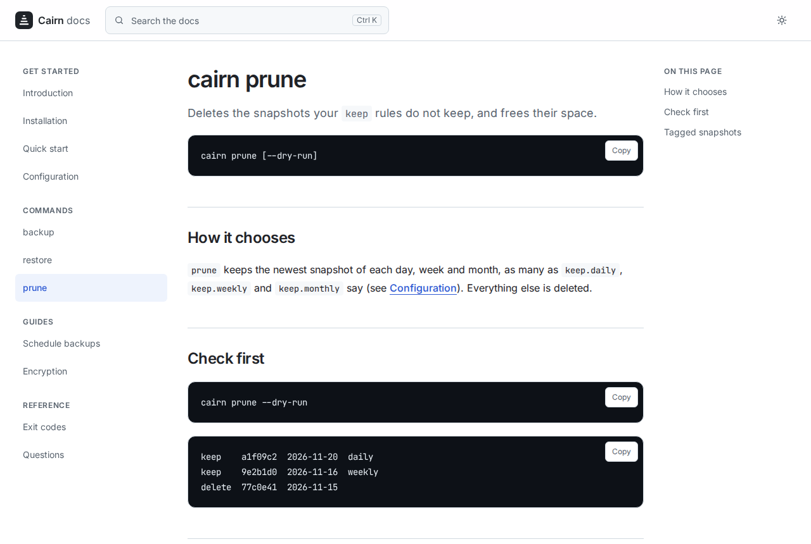

# Docs: a documentation site from Markdown files

Cairn is a made-up command line tool that backs up a folder to object storage, and this is its
documentation. Each page is a Markdown file under `src/routes/docs/`, wrapped by one layout that adds
the menu, the outline of the page, and links to the previous and next pages. Search works twice: a
server page that answers with JavaScript off, and a React island that shows results as you type.



## What it shows

| Nexy feature | Where |
|---|---|
| Markdown pages, served at the address of their file | `src/routes/docs/**/*.md` |
| A layout around every Markdown page, with the outline from `useToc` | `src/routes/docs/layout.nexy` |
| The tab title and the description taken from the page's first heading and paragraph | `src/routes/docs/layout.nexy` |
| The current page marked in the menu with `usePathname` | `src/components/Sidebar.nexy` |
| A JSON route in Python | `src/routes/api/search.py` |
| A search page read from the address with `useSearchParams`, escaped | `src/routes/search.nexy` |
| React islands with `client:load` and `client:idle` | `src/components/*.tsx` |
| `/sitemap.xml` and `/robots.txt` from `useSiteUrl` | `nexyconfig.py` |
| `/docs` given to the site: the API reference is turned off with `useDocs = False` | `nexyconfig.py` |
| A 404 page that offers the search | `src/routes/notfound.nexy` |
| Tests of the menu, the search and every page, without a browser | `tests/` |

## Run it

You need Python 3.12 or newer, [uv](https://docs.astral.sh/uv/), and Node.js with npm, pnpm or
bun.

```bash
git clone https://github.com/NexyPy/nexy
cd nexy/examples/docs
uv sync
npm install          # or pnpm install, bun install
uv run nexy dev
```

Open the address `nexy dev` prints. In development the islands are rendered in the browser only;
`uv run nexy build` then `uv run nexy start` serves them inside the HTML, which is the version to
try with JavaScript off.

## Write a page

1. Add a Markdown file under `src/routes/docs/`: `guides/restore-a-laptop.md` answers at
   `/docs/guides/restore-a-laptop`.
2. Start it with one `# heading`: it names the tab. The first paragraph is the description search
   engines show.
3. Add the page to its section in `src/docs/nav.py`. The menu, the previous and next links and the
   search all read that list, and a test fails when a file is missing from it.

`##` and `###` headings make the outline on the right. They are also what search finds: a result
links to the heading it was found under.

## Search, with and without JavaScript

`src/docs/search.py` reads every page of the menu once, cuts it at its headings, and keeps the text
of each part. A query finds the parts that hold every one of its words, a word in a title first.

- **`/search?q=...`** is a server page. It is what the search box sends with JavaScript off, and what
  Enter opens when no result is chosen.
- **`/api/search?q=...`** answers the same results as JSON.
- **`search-box.tsx`** is a real form to `/search`. Once it runs, it asks `/api/search` as you type
  and lists the results under the box: the arrow keys move, Enter opens, Escape closes, and Ctrl K
  or `/` puts the cursor in the box.

## Islands that add, never replace

An island's HTML is rendered once, at build, without the props the page passes. So neither island
here takes props:

- **`search-box.tsx`** renders the form, which works on its own.
- **`code-copy.tsx`** renders nothing. Once it runs, it adds a Copy button to each code block of the
  page. With JavaScript off, the code is still there to select.

## Test it

```bash
uv run pytest
```

The tests check that every file is in the menu and every menu entry has a file, that every search
result links to a heading that exists in the page, and that the search page escapes what it prints.

## Files

```text
src/
  docs/
    nav.py                     the sections and pages of the menu, in reading order
    search.py                  the search over the Markdown files
  components/
    Header.nexy                the name, the search box, the theme switch
    Sidebar.nexy               the menu, current page marked
    ThemeToggle.nexy           light or dark
    search-box.tsx             the search form, then results as you type
    code-copy.tsx              a Copy button on each code block
  routes/
    layout.nexy                the document around every page
    index.nexy                 the home page
    docs/layout.nexy           the menu, the outline, previous and next
    docs/**/*.md               the pages
    search.nexy                search without JavaScript
    api/search.py              search as JSON
    notfound.nexy              the 404 page
  globale.css                  the tokens of the theme, and the style of the Markdown
tests/                         the menu, the search, the pages
```
