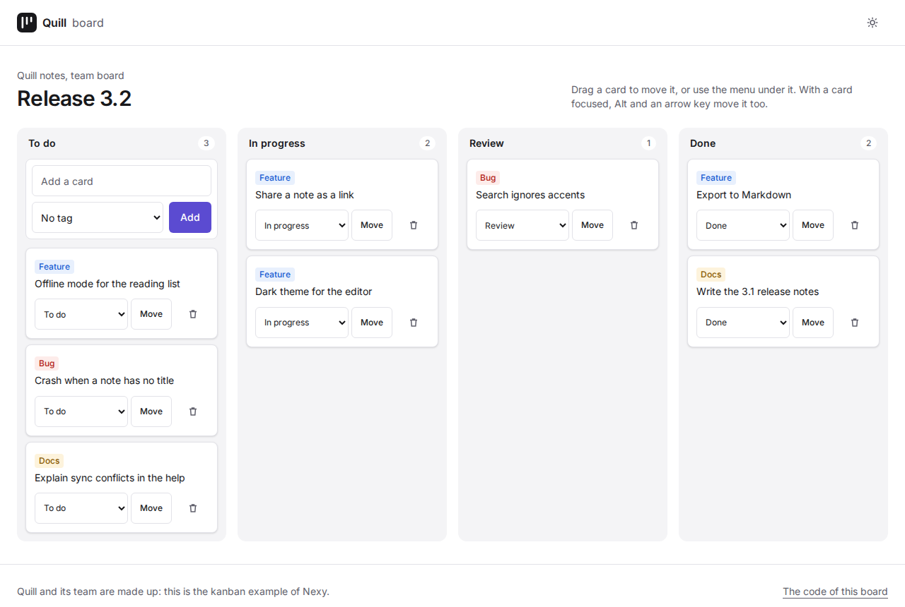

# Kanban: a team board with Solid drag and drop over server actions

Quill is a made-up notes app, and this is the board of its team for the 3.2 release: four columns,
cards with a tag, and a form to add one. The board is server HTML from a `.nexy` page, and the cards
live in SQLite. Every card moves with a small form posted to a Python action, so the board works
with JavaScript off and on a phone. A Solid island adds drag and drop and keyboard moves: it calls
the same actions as functions, then puts the cards in the order the server answered with.



## What it shows

| Nexy feature | Where |
|---|---|
| Actions in Python, posted to by a plain form, with no JavaScript | `src/actions/board.py`, `src/routes/index.nexy` |
| The same actions called from the browser as typed functions, from `@nexy/actions` | `src/components/drag-and-drop.tsx` |
| `__actions_path["name"]` in a template: the address a form posts to | `src/routes/index.nexy` |
| A Solid island with `client:load` that adds to server HTML instead of drawing it | `src/components/drag-and-drop.tsx` |
| A page that reads SQLite in its frontmatter, with the standard library only | `src/board/store.py` |
| Card titles typed by people, printed escaped with the `e` filter | `src/routes/index.nexy` |
| A 404 page | `src/routes/notfound.nexy` |
| Tailwind tokens, light and dark, with a theme switch that does not flash | `src/globale.css`, `src/routes/layout.nexy` |
| Tests of the store, the forms and the actions, without a browser | `tests/` |

## Run it

You need Python 3.12 or newer, [uv](https://docs.astral.sh/uv/), and Node.js with npm, pnpm or
bun.

```bash
git clone https://github.com/NexyPy/nexy
cd nexy/examples/kanban
uv sync
npm install          # or pnpm install, bun install
uv run nexy dev
```

Open the address `nexy dev` prints. The board is kept in `kanban.db`, made with the first cards
the first time the page is opened: delete the file to start again. `KANBAN_DB` puts it somewhere
else.

## Move a card, three ways

1. **The form under each card**: pick a column, press Move. The browser posts the form to the
   `move_card` action, and the action sends it back to the board. It works with JavaScript off and on
   every touch screen.
2. **Drag and drop**, once the island runs: drop a card between two others to put it there.
3. **The keyboard**, once the island runs: focus a card with Tab, then Alt and an arrow key. Up and
   down move it in its column, left and right to the next column. A screen reader hears where it went.

With the island, the forms answer without a reload too: it calls the action, then moves the cards.

## The server decides the order

Every action answers with the whole board. The island moves a dropped card at once, then puts every
card where the answer says. Two people on one board, or a move that failed, end on what the server
holds, never on what the page guessed. A card the page does not know, added in another tab, makes
the page reload.

## An island that adds, never replaces

An island's HTML is rendered once, at build, without the props the page passes. So this one takes
none, and draws only two empty lines: a status line for screen readers, and a line for errors. The
board itself stays server HTML; the island finds it in the page once it runs, and adds the drag
handles and the keys to it.

## Test it

```bash
uv run pytest
```

Each test gets a board of its own in a temporary folder. The tests post the forms the way a browser
does, call the actions the way the island does, and check that a title with HTML in it is printed
as text.

## Files

```text
src/
  board/store.py               the cards in SQLite: read, add, move, remove
  actions/board.py             the actions the forms and the island call
  components/
    Header.nexy                the name and the theme switch
    ThemeToggle.nexy           light or dark
    drag-and-drop.tsx          the Solid island: drag, keys, forms without reload
  routes/
    layout.nexy                the document around every page
    index.nexy                 the board
    notfound.nexy              the 404 page
  globale.css                  the tokens of the theme and the tags
tests/                         the store, the forms, the actions
```
