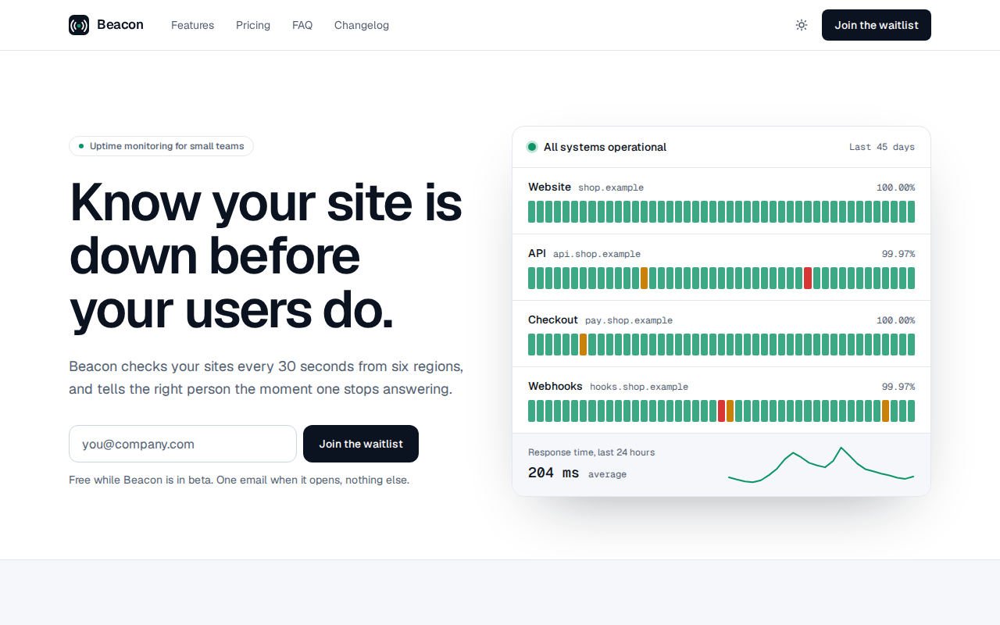

# Landing: a product page that works without JavaScript

Beacon is the site of a made-up uptime monitor: a hero with a live-looking status panel, the
features, the steps, the pricing, the questions and a waitlist. The page is rendered by the server
from `.nexy` files, and only two parts are Preact islands: the pricing switch and the waitlist form.
Both are rendered into the HTML at build, so with JavaScript off the page reads the same and the form
still sends.



## What it shows

| Nexy feature | Where |
|---|---|
| Server pages in `.nexy`, with Python between the `---` lines | `src/routes/index.nexy` |
| Components imported from `.nexy` files, with props | `src/components/StatusPreview.nexy`, `src/components/Icon.nexy` |
| Preact islands with `client:load` and `client:visible`, rendered into the HTML at build | `src/components/pricing.tsx`, `src/components/waitlist-form.tsx` |
| An action called from an island, typed from its Python signature | `src/actions/waitlist.py` |
| A route handler written in Python, for the form without JavaScript | `src/routes/waitlist.py` |
| `useSearchParams` to show the outcome after that form comes back | `src/routes/index.nexy` |
| Page titles with `metadata` and a `title_template` in the layout | `src/routes/layout.nexy` |
| A Markdown page in a nested layout that names the tab after its heading | `src/routes/(pages)/` |
| A 404 page | `src/routes/notfound.nexy` |
| A SQLite table made by an Alembic migration, with `nexy migrate` | `src/models/`, `alembic/versions/` |
| Tailwind tokens, light and dark, with a theme switch that does not flash | `src/globale.css`, `src/components/ThemeToggle.nexy` |
| Tests of the service, the action and the form over HTTP | `tests/` |

## Run it

You need Python 3.12 or newer, [uv](https://docs.astral.sh/uv/), and Node.js with npm, pnpm or
bun.

```bash
git clone https://github.com/NexyPy/nexy
cd nexy/examples/landing
cp .env.example .env
uv sync
npm install                     # or pnpm install, bun install
uv run nexy migrate --upgrade   # creates the waitlist table
uv run nexy dev
```

Open the address `nexy dev` prints. In development the islands are rendered in the browser only;
`uv run nexy build` then `uv run nexy start` serves the page with them in the HTML, which is the
version to try with JavaScript off.

## How the waitlist form works

The form is a real `<form method="post" action="/waitlist">`. Two paths lead to the same function,
`join()` in `src/services/waitlist.py`, which checks the address and stores it once:

- **With JavaScript**, the island stops the browser from posting and calls the `join_waitlist`
  action. The answer replaces the form in place.
- **Without JavaScript**, the browser posts to `src/routes/waitlist.py`, which answers with a
  redirect to `/?waitlist=joined#join`. The page reads that word with `useSearchParams` and shows the
  same sentence the action would have sent.

An address already on the list gets the same answer as a new one, so the form never tells a visitor
who else signed up. The handler reads at most 2 KB of body, and the column holds at most 254
characters, the longest address mail servers accept.

## Change the content

The words are in the pages: the features, steps and questions are lists at the top of
`src/routes/index.nexy`, the plans are at the top of `src/components/pricing.tsx`, and the status
panel draws `src/content/preview.py`. The changelog is `src/routes/(pages)/changelog.md`; another
Markdown file in that folder becomes another page with the same layout.

## Test it

```bash
uv run pytest
```

The tests run the migration once, give each test a fresh copy of that database, and post to the
action and to the form handler the way the browser does.

## Files

```text
alembic/versions/              the subscribers table
src/
  models/subscriber_model.py   the table
  services/waitlist.py         check an address, store it once, the sentences shown
  actions/waitlist.py          what the island calls
  content/preview.py           the made-up monitors of the status panel
  components/                  header, footer, logo, theme switch, status panel, the two islands
  routes/layout.nexy           the document around every page
  routes/index.nexy            the landing page
  routes/waitlist.py           the form handler without JavaScript
  routes/(pages)/              the changelog and its layout
  routes/notfound.nexy         the 404 page
  globale.css                  the tokens of the theme
tests/                         the service, the action and the form handler
```
