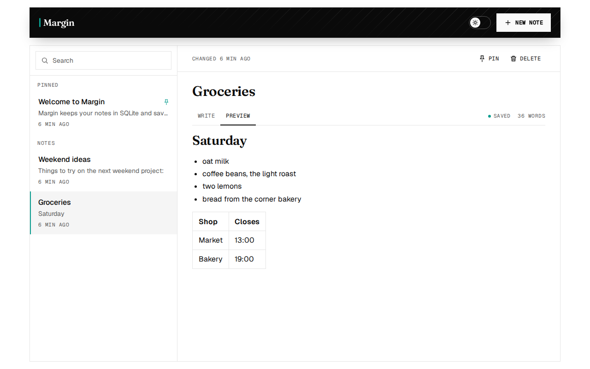

# Notes: a Svelte notebook that saves while you type

Margin is a notebook written in Svelte: notes in Markdown, saved while you type, pinned, searched and
previewed. Every page is a Svelte component the browser routes between, and every read or write is a
Nexy action: a Python function the page calls like a TypeScript one, typed from its signature. The
notes are a SQLite table of Tortoise-ORM, made by Aerich migrations.



## What it shows

| Nexy feature | Where |
|---|---|
| Client mode: Svelte pages, a client router, one document rendered on the server | `nexyconfig.py`, `src/routes/layout.svelte` |
| Actions called from Svelte, with their TypeScript types | `src/actions/notes.py`, `src/lib/notes.ts` |
| An async ORM behind sync and async code, on a loop of its own | `src/configs/db.py` |
| `useBlocker` that saves before a navigation instead of asking | `src/routes/notes/[id].svelte` |
| A 404 from an action with `notFound()`, shown by the page | `src/actions/notes.py`, `src/routes/notes/[id].svelte` |
| A dynamic route whose parameter arrives as a prop | `src/routes/notes/[id].svelte` |
| The current address as a store, to lay the page out | `src/routes/layout.svelte` |
| Tortoise-ORM and Aerich migrations, with `nexy migrate` | `src/models/`, `migrations/` |
| UnoCSS with the tokens of the starter, light and dark | `uno.config.ts`, `src/globale.css` |
| Tests of every action over HTTP, on the migrated database | `tests/` |

## Run it

You need Python 3.12 or newer, [uv](https://docs.astral.sh/uv/), and Node.js with npm, pnpm or
bun.

```bash
git clone https://github.com/NexyPy/nexy
cd nexy/examples/notes
cp .env.example .env
uv sync
npm install                     # or pnpm install, bun install
uv run nexy migrate --upgrade   # creates the table and writes three first notes
uv run nexy dev
```

Open the address `nexy dev` prints.

## How a note is saved

There is no save button. The editor calls the `save_note` action 600 ms after the last key, and
again before any navigation: `useBlocker` takes a function, and the router waits for it before it
leaves the page. A note left with no title and no text is deleted on the way out, so a click on
**New note** leaves nothing behind.

The editor never writes the answer of the server back into the fields: a key typed while a save
was on its way stays where it was typed. Each save carries the id, the title and the text of the
moment it was asked for, so a save for one note can never land on the next one.

The Markdown is rendered by the server, for the **Preview** tab, with raw HTML turned off: a
`<script>` typed in a note is shown as text.

## Test it

```bash
uv run pytest
```

The tests run the migrations of `migrations/`, empty the table before each test, and call the
actions over HTTP the way the pages do.

## Files

```text
migrations/models/       the table, then the three first notes
src/
  models/note_model.py   the table of notes
  services/              every query, and Markdown to HTML
  actions/notes.py       what the pages call
  configs/db.py          Tortoise on a loop of its own, for sync and async code
  lib/notes.ts           the list shared by the sidebar and the editor
  lib/time.ts            "12 min ago", and how many words
  components/            the header, the search, the list, a row, pin and delete
  routes/layout.svelte   the document: the list beside the page, or alone on a phone
  routes/index.svelte    the page beside the list before a note is open
  routes/notes/[id].svelte  one note, in Markdown, saved while you type
  globale.css            the tokens of the theme and the style of a preview
tests/                   Markdown, the service and the actions, on a migrated database
```
