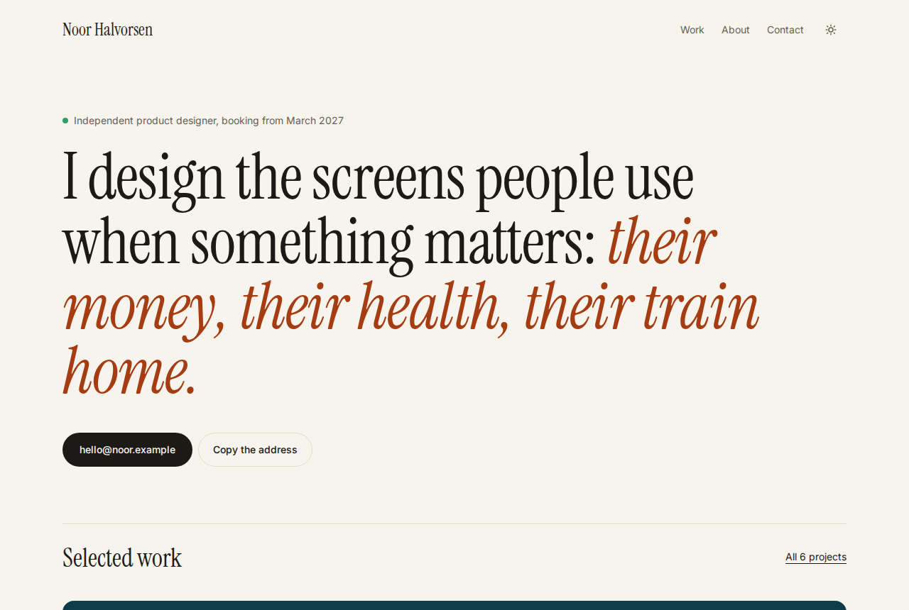

# Portfolio: a designer's site with Svelte islands

Noor Halvorsen is a made-up product designer, and this is her site: a home page with her selected
work, the list of her case studies with a filter by discipline, one page per case study with a
gallery, and an about page. The pages are `.nexy` files rendered by the server. Three small parts
are Svelte islands: copying her email address, her local time, and the gallery's lightbox. Each one
is something extra: with JavaScript off, the page reads the same and every link still works.



## What it shows

| Nexy feature | Where |
|---|---|
| Server pages in `.nexy`, with Python between the `---` lines | `src/routes/` |
| Svelte islands with `client:load`, `client:idle` and `client:visible` | `src/components/*.svelte` |
| A dynamic route, and a 404 from Python with `notFound()` | `src/routes/work/[slug].nexy` |
| ISR: a case study is rendered once, then served from memory with `revalidate = 300` | `src/routes/work/[slug].nexy` |
| A filter read from the address with `useSearchParams`, with no cache on purpose | `src/routes/work/index.nexy` |
| The current page marked in the menu with `useIsActive` | `src/components/Header.nexy` |
| A component that takes a Python object | `src/components/ProjectCard.nexy` |
| `/sitemap.xml` and `/robots.txt` from `useSiteUrl` | `nexyconfig.py` |
| A 404 page | `src/routes/notfound.nexy` |
| Tailwind tokens, light and dark, with a theme switch that does not flash | `src/globale.css`, `src/routes/layout.nexy` |
| Tests of every page, the cache headers and the sitemap, without a browser | `tests/` |

## Run it

You need Python 3.12 or newer, [uv](https://docs.astral.sh/uv/), and Node.js with npm, pnpm or
bun.

```bash
git clone https://github.com/NexyPy/nexy
cd nexy/examples/portfolio
uv sync
npm install          # or pnpm install, bun install
uv run nexy dev
```

Open the address `nexy dev` prints. In development the islands are rendered in the browser only;
`uv run nexy build` then `uv run nexy start` serves them inside the HTML, which is the version to
try with JavaScript off.

## Islands that add, never replace

An island's HTML is rendered once, at build, without the props the page passes. So each island here
keeps what it shows inside itself, and adds to the page instead of drawing it:

- **`copy-email.svelte`** renders the `mailto:` link. Once it runs, it adds a button that copies the
  address, and says so when the browser refuses.
- **`local-time.svelte`** renders the city. A time written at build would be wrong for everyone, so
  the time appears once the island runs, and stays current.
- **`lightbox.svelte`** renders a closed dialog. The gallery itself is server HTML: links to the full
  pictures. The island opens those links in the dialog, with the arrow keys to move and Escape to
  close.

The lightbox uses `client:idle`, not `client:visible`: its first element is a closed dialog, which has
no box on the page, so it never becomes visible.

## Which pages are cached

`revalidate = 300` in `src/routes/work/[slug].nexy` keeps each case study in memory for five
minutes per address, and answers with `cache-control: public, s-maxage=300`. After that, the old page
is served while a new one is rendered in the background. An address with no case study answers 404
and is not kept.

`/work` has no `revalidate`: the cache keys on the path alone, so `/work?discipline=brand` and
`/work` would share one page. A filtered list is cheap to render; it is rendered every time.

## Change the content

The case studies are a list of `Project` in `src/content/work.py`: the words, the numbers, and the
pictures under `public/work/<slug>/`. A new entry is a new page at `/work/<slug>`, in the list and the
filter. The sitemap lists the fixed pages only: Nexy cannot know the values of `[slug]`. The about page keeps its words in its own frontmatter.

## Test it

```bash
uv run pytest
```

The tests ask the site for its pages without starting a server, and empty the page cache before
each test so that no test sees another's pages.

## Files

```text
src/
  content/work.py              the case studies, the disciplines, and finding one
  components/
    Header.nexy, Footer.nexy   the menu, the contact block
    ProjectCard.nexy           a case study in a list
    ThemeToggle.nexy           light or dark
    copy-email.svelte          the email link, then the copy button
    local-time.svelte          the city, then the time there
    lightbox.svelte            the gallery's dialog
  routes/
    layout.nexy                the document around every page
    index.nexy                 the home page
    work/index.nexy            every case study, filtered by discipline
    work/[slug].nexy           one case study, kept five minutes
    about.nexy                 about Noor
    notfound.nexy              the 404 page
  globale.css                  the tokens of the theme
public/work/                   the covers and pictures, one folder per case study
tests/                         the content, the pages, the cache, the sitemap
```
