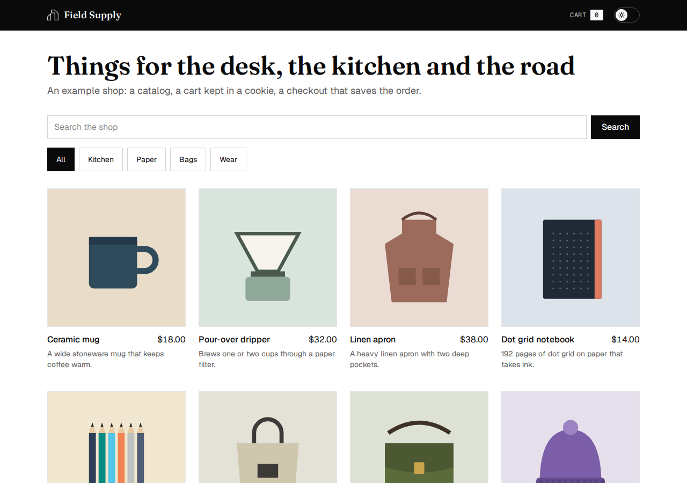

# Store

Field Supply, a small shop: browse and search a catalog, add to a cart, change quantities, check
out, and get an order page. The pages are rendered by Python on the server, the cart is kept in a
signed cookie, the orders in SQLite, and the Add to cart button and the cart count are Svelte
components.



## What it shows

| Nexy feature | Where |
|---|---|
| Search and category filter in the address, so a result can be shared | `src/routes/index.nexy` |
| A dynamic segment, and a 404 for an unknown product (`notFound()`) | `src/routes/products/[slug].nexy` |
| A Svelte component calling a server action like a function | `src/components/AddToCart.svelte`, `add_to_cart` in `src/actions/cart.py` |
| Two components that talk through a browser event | `AddToCart.svelte` and `CartBadge.svelte` |
| A cart in the session cookie (`useSession`), no account needed | `src/store/session.py` |
| Forms that post to actions and work without JavaScript | `src/routes/cart.nexy`, `src/routes/checkout.nexy` |
| Validation on the server, each field keeps what was typed and says what is wrong | `problems()` in `src/store/checkout.py` |
| An order page only its buyer sees | `src/routes/orders/[number].nexy` |
| Tests of the catalog, the cart and the checkout | `tests/` |

## Run it

```bash
git clone https://github.com/NexyPy/nexy && cd nexy/examples/store
cp .env.example .env    # then put a secret of your own in SESSION_SECRET
uv sync
bun install             # or npm install, pnpm install
uv run nx dev
```

Open the address `nx dev` prints. Orders are kept in `store.db`; nothing is charged and nothing is
sent.

## Change the catalog

The products are in `src/store/catalog.py`, and each has a picture at
`public/products/<slug>.svg`. A shop with many products would keep them in the database next to
the orders.

## Test it

```bash
uv run pytest
```

## Files

```text
src/
  routes/index.nexy                the catalog: search and categories
  routes/products/[slug].nexy      one product
  routes/cart.nexy                 the cart: quantities, remove, totals
  routes/checkout.nexy             the checkout form
  routes/orders/[number].nexy      the order, for its buyer
  actions/cart.py                  add to cart, set a quantity, place the order
  store/catalog.py                 the products
  store/cart.py                    the cart: add, change, totals, shipping
  store/checkout.py                validation, and the order saved with its lines
  store/session.py                 what the session cookie keeps
  models/order.py                  Order and OrderLine
  components/AddToCart.svelte      quantity and Add to cart
  components/CartBadge.svelte      the count in the header
tests/                             catalog, cart and checkout
```
