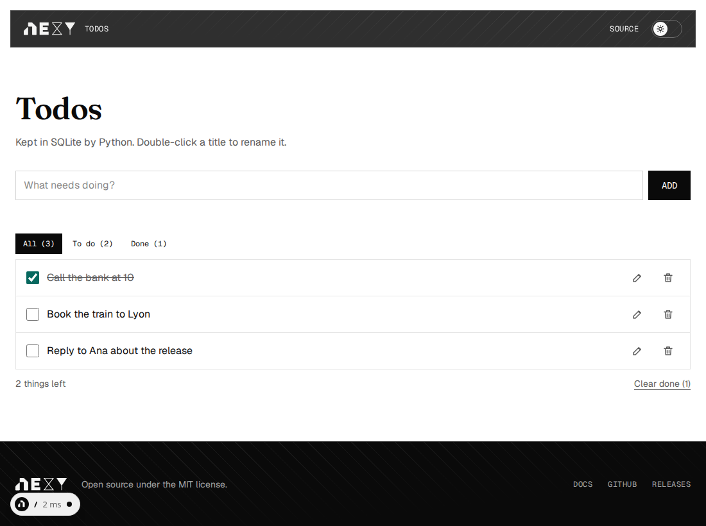

# Todos

A todo list kept in SQLite by Python, with a React page. Add, tick, rename and delete things to
do, filter them, and clear the done ones: every change goes through a server action and the page
shows the list the database answers with.



## What it shows

| Nexy feature | Where |
|---|---|
| Server actions, called from React like functions (`@nexy/actions`) | `src/actions/todos.py`, `src/routes/index.tsx` |
| SQLModel with SQLite, tables created at startup | `src/models/todo.py`, `src/configs/db.py` |
| Validation on the server, its reason shown on the page | `problem()` in `src/services/todos.py` |
| A change shown at once, then replaced by the answer of the server | `toggle()` in `src/routes/index.tsx` |
| Tests of the actions against a real database | `tests/test_todos.py` |

## Run it

```bash
git clone https://github.com/NexyPy/nexy && cd nexy/examples/todos
uv sync
bun install          # or npm install, pnpm install
uv run nx dev
```

Open the address `nx dev` prints. The list is kept in `todos.db`; set `DATABASE_URL` in `.env`
(see `.env.example`) to use PostgreSQL or MySQL instead, with its driver added to `pyproject.toml`.

## Test it

```bash
uv run pytest
```

## Files

```text
src/
  actions/todos.py       the six actions the page calls
  services/todos.py      every read and write of the list, and the validation
  models/todo.py         the Todo table
  configs/db.py          the engine, from DATABASE_URL
  routes/index.tsx       the page
  components/todo-item.tsx  one row: checkbox, title, rename and delete
tests/test_todos.py      the actions against a temporary SQLite file
```
